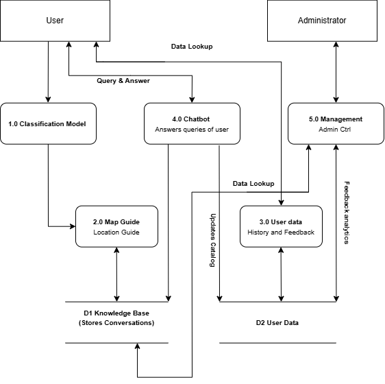
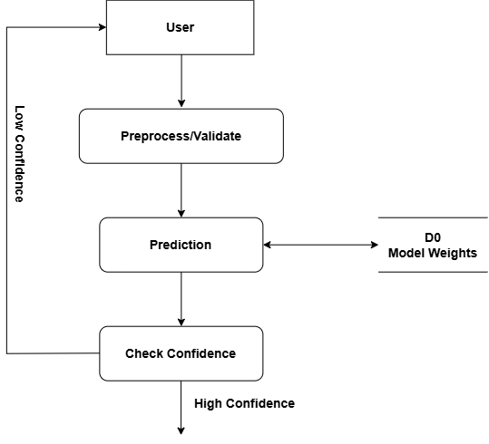
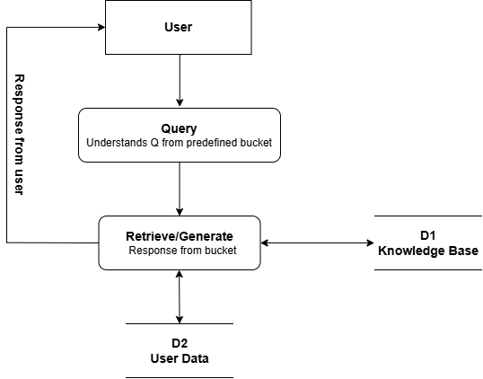
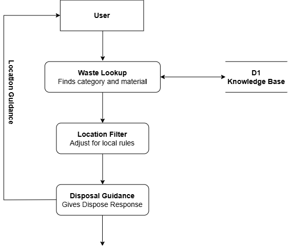
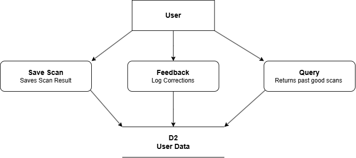
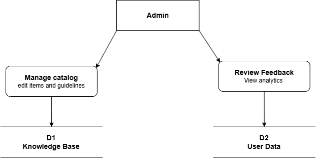
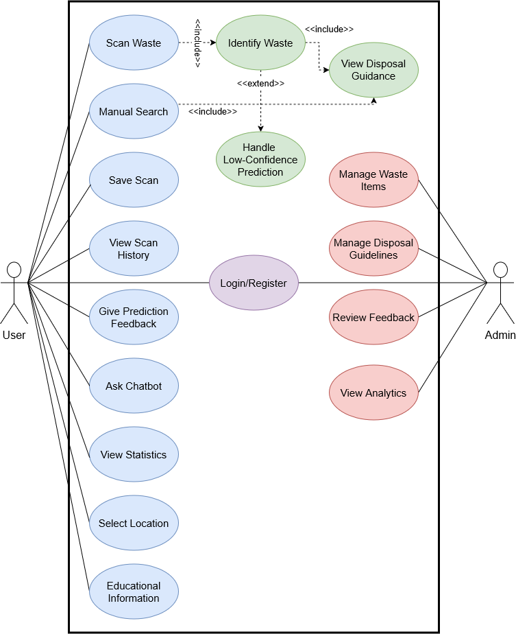

# Sortify

> **AI-Powered Waste Identification & Disposal Guidance**  
> An intelligent cross-platform mobile and web system that bridges the gap between raw computer vision predictions and actionable, real-world disposal instructions.

[](https://thapar.edu)
[](https://expo.dev)
[](https://fastapi.tiangolo.com)
[](https://docs.ultralytics.com)
[](https://huggingface.co/Qwen/Qwen2.5-1.5B-Instruct)
[](LICENSE)

---

## The Problem

Most people want to dispose of everyday waste properly, but practical sorting is confusing:

- **Classification is not guidance**: Knowing an item is a "paper coffee cup" doesn't answer whether the polyethylene lining makes it non-recyclable in your local area.
- **Preparation matters**: Recyclable plastics contaminated with food residue end up in landfills. Items need specific prep steps (rinsing, removing foil seals, separating bottle caps).
- **Hazard & E-waste risks**: Discarding lithium-ion batteries or blister medicine packs into standard bins causes fire and chemical contamination risks.
- **Information is fragmented**: Searching municipal recycling portals mid-disposal creates too much friction for regular habits.

**Sortify** focuses on reducing decision friction right at the bin: snap a photo, get an instant item prediction with confidence metrics, and immediately see clear, step-by-step prep and disposal instructions.

---

## Core Capabilities

| Capability | How It Works | Real-World Benefit |
| :--- | :--- | :--- |
| **Point & Identify** | Camera capture or image upload evaluated through a FastAPI-hosted YOLOv11 vision detector (`best.pt`), with sample items for offline exploration. | Sub-second classification with normalized bounding-box overlays and sub-item selection across 41 catalog entries. |
| **Actionable Guidance** | Predictions map directly into a curated disposal catalog detailing preparation steps, material context, and safety notes. | Users get immediate instructions: *"Rinse container, crush, dispose cap in plastics bin."* |
| **Confidence Fallbacks** | Low-confidence or ambiguous captures prompt the user with ranked alternative suggestions or a manual search fallback. | Prevents model uncertainty from leading to incorrect disposal behavior. |
| **Grounded Assistant** | A retrieval-augmented (RAG) assistant powered by `rag.txt` and Qwen 2.5 1.5B Instruct (with local keyword fallback) answering specific questions (*"Can I recycle greasy pizza boxes?"*). | Handles edge cases and ambiguous composite materials naturally without hallucinating rules. |
| **Location-Aware Context** | Optional foreground location lookup via OpenStreetMap Overpass & Nominatim (with Google Maps fallback) for specialist drop-offs. | Helps users locate nearby recycling, e-waste, and medical disposal points. |
| **History & Activity** | On-device persistence of scanned items, weekly/categorical charts, progressive milestones, and user corrections. | Users can track sorting habits while flagging misclassifications for review. |
| **Admin Catalog Control** | Administrative interface to curate waste categories, guidelines, and inspect submitted user corrections. | Keeps disposal rules accurate without requiring model redeployment. |

---

## Supported Waste Streams

Sortify structures items into 5 actionable disposal streams:

```text
┌─────────────────────────────────────────────────────────────────────────┐
│                           SUPPORTED STREAMS                             │
├──────────────┬──────────────┬──────────────┬──────────────┬─────────────┤
│  Recyclable  │   Organic    │General Waste │   E-Waste    │  Hazardous  │
│  Plastics,   │ Food scraps, │ Flexible     │   Cables,    │ Batteries,  │
│  paper, tins,│  biodegrad-  │ films, PPE,  │ accessories, │ chemicals,  │
│    glass     │     ables    │ composites   │  batteries   │  medicines  │
└──────────────┴──────────────┴──────────────┴──────────────┴─────────────┘
```

---

## System Architecture

Sortify is engineered as a decoupled client-service architecture separating cross-platform UI, object detection inference, grounded RAG responses, and on-device state:

```text
  ┌─────────────────────────────────────────┐
  │   Expo / React Native App (iOS/And/Web) │
  │  (Camera, Guide, Assistant, Activity)   │
  └──────────┬──────────────────┬───────────┘
             │ HTTP / REST      │ Foreground Location
             ▼                  ▼
  ┌─────────────────────┐  ┌──────────────────────────┐
  │   FastAPI Service   │  │  OpenStreetMap Overpass  │
  │  (/v1/detections,   │  │  & Nominatim (Optional)  │
  │   /v1/assistant/*)  │  └──────────────────────────┘
  └──┬──────────────┬───┘
     │              │
     ▼              ▼
┌──────────┐  ┌──────────────────────────────────────┐
│ YOLOv11  │  │ RAG Assistant Engine                 │
│ Detector │  │ (rag.txt + Qwen 2.5 1.5B Instruct)   │
│ (best.pt)│  └──────────────────────────────────────┘
└──────────┘
```

### System Context (Level-0 DFD)

High-level boundary showing primary interactions between users, administrators, and external contextual sources:

<p align="center">
  
</p>

### Functional Processes (Level-1 DFD)

Decomposition of system processes including authentication, image ingestion, model scoring, guidelines lookup, and feedback telemetry:

<p align="center">
  
</p>

### Detailed Subsystem Workflows (Level-2 DFDs)

<details>
<summary><b>1. Machine Learning Inference Pipeline</b> (Click to expand)</summary>
<br>

Covers image validation, normalization, forward pass through the classification model, confidence threshold verification, and fallback routing:

<p align="center">
  
</p>
</details>

<details>
<summary><b>2. Conversational Assistant (RAG Chatbot)</b> (Click to expand)</summary>
<br>

Shows user query parsing, retrieval from the verified waste database, response synthesis, and conversation persistence:

<p align="center">
  
</p>
</details>

<details>
<summary><b>3. Location-Aware Disposal Guidance</b> (Click to expand)</summary>
<br>

Illustrates how regional waste rules and facility mappings supplement raw category instructions:

<p align="center">
  
</p>
</details>

<details>
<summary><b>4. User Scan History & Feedback Loop</b> (Click to expand)</summary>
<br>

Handles scan logging, user habit summaries, and misclassification reporting for model retraining:

<p align="center">
  
</p>
</details>

<details>
<summary><b>5. Administrative Catalog Management</b> (Click to expand)</summary>
<br>

CRUD workflows for managing supported waste classes, safety tips, and monitoring telemetry:

<p align="center">
  
</p>
</details>

---

## Functional Scope & UML Diagrams

The application models actors across standard end-users and administrators:

<p align="center">
  
</p>

<details>
<summary><b>Additional UML &amp; Architecture Diagrams</b> (Activity, Class, ER, Sequence, Deployment, Collaboration)</summary>
<br>

- **Activity Diagram**: `docs/diagrams/activity_diagram/activity.png`
- **Class Diagram**: `docs/diagrams/class_diaagram/ClassDiagram.png`
- **Entity-Relationship Diagram**: `docs/diagrams/er_diagram/er.png`
- **Sequence Diagram**: `docs/diagrams/sequence_diagram/Sequence.png`
- **Deployment Diagram**: `docs/diagrams/deployment_diagram/deployment_diagram.png`
- **Collaboration Diagrams**:
  - Waste Disposal: `docs/diagrams/collaboration_diagram/waste_disposal.png`
  - RAG Assistant: `docs/diagrams/collaboration_diagram/rag.png`
  - Admin Management: `docs/diagrams/collaboration_diagram/admin_management.png`
  - CI/CD Pipeline: `docs/diagrams/collaboration_diagram/ci&cd.png`

</details>

---

## Tech Stack

| Component | Technology | Role |
| :--- | :--- | :--- |
| **Client App** | Expo SDK 57, React Native 0.86, TypeScript | Cross-platform mobile (iOS/Android) and web UI with `expo-router`, camera/image picker, and responsive layout. |
| **Backend API** | FastAPI (`>=0.115`), Uvicorn, Pillow | Asynchronous REST endpoints (`/health`, `/v1/models`, `/v1/detections`, `/v1/assistant/chat`, `/v1/assistant/rag-info`). |
| **ML Inference** | Ultralytics (`>=8.3`, YOLOv11) | Object detection supporting the 8-class streamlined `best.pt` model, 10-class Sortify model, and optional COCO fallback. |
| **Conversational RAG** | `rag.txt` + Qwen 2.5 1.5B Instruct | Grounded retrieval-augmented assistant with trace telemetry and client-side catalog fallback. |
| **Local Storage** | AsyncStorage (`@react-native-async-storage/async-storage`) | On-device persistence for user profile, scan history, feedback, and chat threads under `sortify-prototype-v1`. |
| **Location Services** | `expo-location`, OpenStreetMap Overpass & Nominatim | Optional one-time foreground lookup for area labels and nearby specialist disposal points. |
| **Tooling & Testing** | Pytest, Node test scripts, ESLint, Prettier, MkDocs | Unit/integration tests for mappings and RAG, static checks, and documentation builds. |

---

## Repository Structure

```text
ucs503p-202627-sortify/
├── README.md                          # Project overview and setup entry point
├── code/                              # Application source code and backend
│   ├── src/                           # Expo / React Native client source
│   │   ├── app/                       # expo-router screen routes
│   │   ├── features/                  # Screen logic (scan, result, guide, assistant, history, profile, admin)
│   │   ├── components/                # Shared UI components
│   │   ├── services/                  # Recognition mapping, assistant client, nearby disposal, location
│   │   ├── state/                     # Local AsyncStorage state provider
│   │   ├── data/                      # 41-item waste disposal catalog
│   │   └── constants/                 # Theme tokens and palettes
│   ├── server/                        # FastAPI inference and RAG service
│   │   ├── app/                       # main.py (API routes) and rag.py (RAG engine)
│   │   ├── models/                    # Trained YOLOv11 checkpoint (best.pt) and class mapping JSON
│   │   ├── rag.txt                    # Grounded waste-disposal knowledge base
│   │   └── requirements.txt           # Python backend dependencies
│   ├── tests/                         # Python (pytest) and Node (.cjs) unit tests
│   ├── ios/ & android/                # Native mobile project directories
│   └── package.json                   # Expo / React Native dependencies and scripts
├── docs/                              # Project documentation, test cases, Gantt chart, and diagrams
│   ├── diagrams/                      # DFDs, Use Case, Activity, Class, ER, Sequence, Deployment, Collaboration
│   └── journals/ -> ../journals       # Symlinked student development journals
├── journals/                          # Weekly engineering logs per team member
├── project-proposal/                  # Proposal report (LaTeX source and PDF)
├── project-report-prototype-stage/    # Prototype deliverable documentation and screenshots
├── project-report-final/              # Final engineering evaluation report
├── mkdocs.yml                         # Documentation generator configuration
├── pyproject.toml                     # Python project and pytest configuration
└── Makefile                           # Documentation build automation
```

---

## Getting Started

### 1. Clone the Repository

```bash
git clone https://github.com/Daksh-Aggarwal/ucs503p-202627-sortify.git
cd ucs503p-202627-sortify
```

### 2. Backend Inference & RAG Server (`code/server`)

Ensure you have Python 3.10+ installed:

```bash
cd code/server
python3 -m venv .venv
source .venv/bin/activate
pip install -r requirements.txt
cp .env.example .env
set -a; source .env; set +a
uvicorn app.main:app --host 0.0.0.0 --port 8000 --reload
```

Verify the server is running and the model is loaded at `http://127.0.0.1:8000/health`. For full details on model switching and RAG configuration, see [code/server/README.md](code/server/README.md).

### 3. Mobile & Web Client (`code`)

Requires Node.js 22.13+ (for Expo SDK 57):

```bash
cd code
npm install
cp .env.example .env
# Set EXPO_PUBLIC_INFERENCE_API_URL in .env (use your LAN IP for physical devices)
npm run web
# Or launch Expo for iOS / Android:
npm run start
```

Additional client checks and details are documented in [code/README.md](code/README.md):

```bash
npm run typecheck
npm run lint
npm run build:web
```

### 4. Running Tests

```bash
# Python backend & RAG tests (from repo root)
pytest

# Client mapping, parser, and service tests
node code/tests/test_class_mapping.cjs
node code/tests/test_assistant_service.cjs
node code/tests/test_block_parser.cjs
node code/tests/test_detection_threshold.cjs
node code/tests/nearby-disposal.cjs
```

### 5. Local Documentation Server

To review the MkDocs documentation locally:

```bash
make docserve
```

---

## Academic Context

This project is submitted as part of **UCS503P: Software Engineering Project** at **Thapar Institute of Engineering and Technology (TIET)**, Patiala (2026–27 Odd Semester).

- **Course Instructor**: Dr. Jeelani Asif
- **Team Members**:
  - **Daksh Aggarwal** (Roll No: `1024160015`) — [daggarwal_be24@thapar.edu](mailto:daggarwal_be24@thapar.edu)
  - **Mankirat Singh** (Roll No: `1024160002`) — [msingh3_be24@thapar.edu](mailto:msingh3_be24@thapar.edu)
  - **Saket Gatyan** (Roll No: `1024160028`) — [sgatyan_be24@thapar.edu](mailto:sgatyan_be24@thapar.edu)

---

## License

This project is licensed under the [MIT License](LICENSE).
